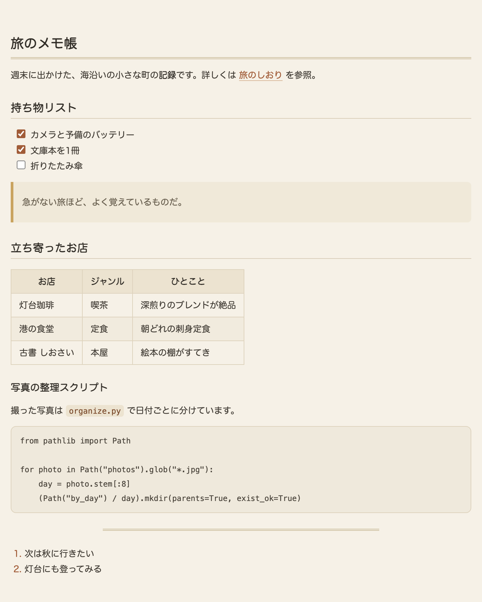

# Paper Markdown Preview Theme

紙っぽい、温かみのある色合いの VS Code Markdown プレビュー用ライトテーマです。



- 生成り色の背景と、こげ茶系の文字色
- 丸ゴシック系のフォント（`ui-rounded` / ヒラギノ丸ゴ）
- 見出し・引用・コード・テーブルまで同じトーンで統一
- VS Code 本体がダークテーマでも、プレビューだけこの見た目になる

## インストール

[Releases](https://github.com/KareKyasu/paper-markdown-theme/releases) から `.vsix` をダウンロードして、

```bash
code --install-extension paper-markdown-theme-1.0.0.vsix
```

ソースから作る場合:

```bash
npx @vscode/vsce package
```

## 使い方

インストールするだけで、Markdown プレビュー（`Cmd+Shift+V`）に自動で適用されます。

## License

MIT
