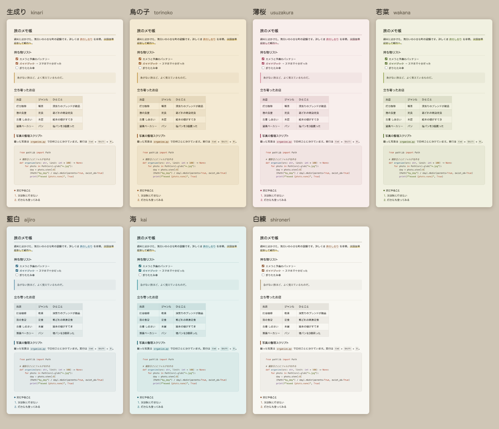

# Kinari

生成り（きなり）色の紙のような、温かみのある VS Code Markdown プレビューテーマです。和紙の色を6種類から選べます。


- 生成り色をはじめとした、和紙のような背景色
- 丸ゴシック系のフォント（`ui-rounded` / ヒラギノ丸ゴ）と、読みやすい字間
- 見出し・引用・コード・テーブル・キー表示・マーカーまで同じトーンで統一
- コードの色分けも紙に合う配色（VS Code がダークテーマでも読みやすい）
- VS Code 本体がダークテーマでも、プレビューだけ明るい紙の見た目になる

## 和紙の色



| 和紙 | 設定値 | 色合い |
| --- | --- | --- |
| 生成り（きなり） | `kinari`（既定） | 漂白していない、ほんのり黄みの白 |
| 鳥の子（とりのこ） | `torinoko` | 卵の殻のような、少し濃いめの和紙色 |
| 薄桜（うすざくら） | `usuzakura` | 桜の花びらのような、ごく淡い紅 |
| 若菜（わかな） | `wakana` | 春の若菜のような、淡い黄緑 |
| 藍白（あいじろ） | `aijiro` | 藍染めのいちばん淡い、白に近い水色 |
| 白練（しろねり） | `shironeri` | 練り絹のような、ほとんど白 |

プレビュー右上の 🎨 ボタン（またはコマンドパレットの「Kinari: 和紙を選ぶ」）で選べます。矢印キーで選んでいる間もプレビューに反映されるので、見比べながら選べます。Enter で決定、Esc で元の色に戻ります。

## インストール

[Releases](https://github.com/KareKyasu/kinari-markdown-preview/releases) から `.vsix` をダウンロードして、

```bash
code --install-extension kinari-1.1.0.vsix
```

ソースから作る場合:

```bash
npx @vscode/vsce package
```

## 使い方

インストールするだけで、Markdown プレビュー（`Cmd+Shift+V`）に自動で適用されます。

## 設定

| 設定 | 説明 |
| --- | --- |
| `kinari.paper` | 和紙の色（上の表の設定値）。既定は `kinari` |
| `markdown.preview.fontSize` | 文字の大きさ（VS Code 標準の設定、既定 14） |

- フォント（丸ゴシック）と行間（1.65）は Kinari 固定のため、`markdown.preview.fontFamily` と `markdown.preview.lineHeight` は効きません。
- `kinari.paper` はウィンドウ単位の設定です。マルチルートワークスペースで、フォルダごとに変えることはできません。
- 動作には VS Code 1.78 以降が必要です。

## License

MIT
